<div align="center">

<picture>
  <source media="(prefers-color-scheme: dark)" srcset="docs/media/logo-dark.svg">
  
</picture>

### Document intelligence with answers you can verify

Ask questions across PDFs, scans, contracts, spreadsheets, slide decks and recordings.<br>
Every claim cites the page it came from, and every sentence is checked against its source.

[](LICENSE)
[](requirements.txt)
[](frontend/package.json)
[](#development)
[](#benchmarks)
[](#benchmarks)
[](#deployment)

[**Watch the demo**](docs/media/omnidoc-demo.mp4) · [Quick start](#quick-start) · [Features](#features) · [Benchmarks](#benchmarks) · [Architecture](#architecture) · [Deployment](#deployment)

<br>

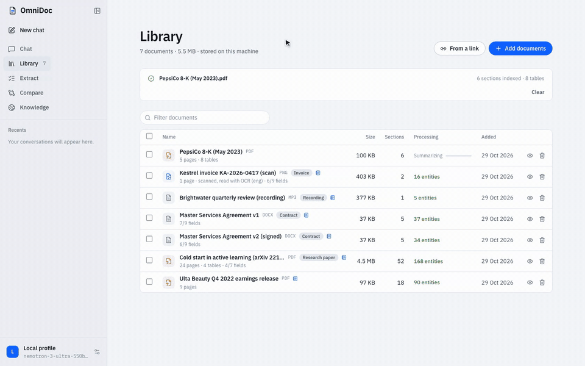

</div>

<br>

## Why OmniDoc

Most document assistants give fluent answers you cannot check. OmniDoc is built the other way round:
retrieval, reading and calculation are done by specialised agents, and the answer is only as strong
as the evidence it cites.

- **Verifiable.** Answers cite numbered sources. A citation opens the document at the cited page with the supporting sentence highlighted, and a verifier checks each sentence before you read it.
- **Exact.** Figures come from the documents, calculations run in a restricted symbolic evaluator, tables are queried with SQL, and charts are drawn only from cited numbers.
- **Every format.** PDFs, scans and photos (OCR, Indian languages included), Word, spreadsheets, slides, e-mails, e-books, web pages and audio or video recordings.
- **Yours.** Runs on free hosted model APIs or entirely on your machine with Ollama. Documents, indexes and conversations stay in your data folder.

<div align="center">

[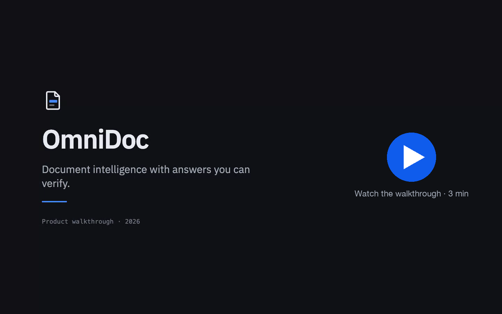](docs/media/omnidoc-demo.mp4)

<sub>Three-minute walkthrough with subtitles. Music: “Inspired” by Kevin MacLeod (incompetech.com), CC BY 4.0.</sub>

</div>

## Features

<table>
<tr>
<td width="50%" valign="top">

**Cited answers, checked sentence by sentence**<br>
Answers stream in as they are written. Each sentence is checked against the passages it cites: figures must appear there, wrong citation numbers are corrected, and unsupported claims are flagged with the reason.

</td>
<td width="50%">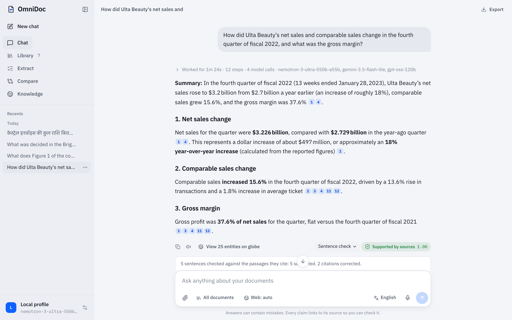</td>
</tr>
<tr>
<td>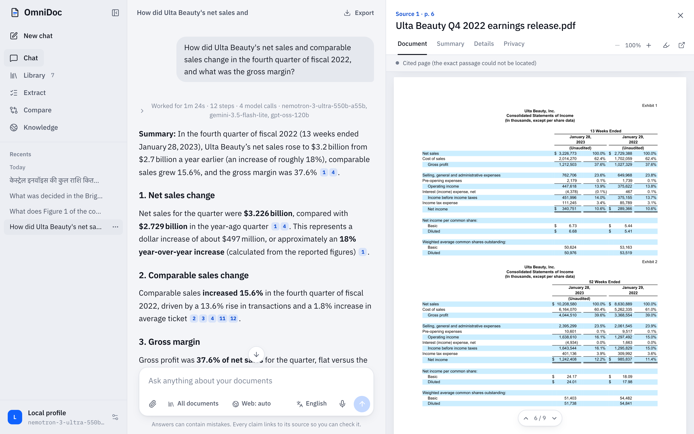</td>
<td valign="top">

**Open the evidence**<br>
Clicking a citation opens the document beside the answer at the cited page and highlights the sentence that supports the claim. Scanned pages are highlighted from their OCR word positions; recordings play from the cited moment.

</td>
</tr>
<tr>
<td valign="top">

**Statements, tables and calculations**<br>
Financial statements a question needs are added whole, even when split over two pages. Tables are queried with read-only SQL, ratios follow standard definitions, and every computed figure shows its inputs and formula.

</td>
<td>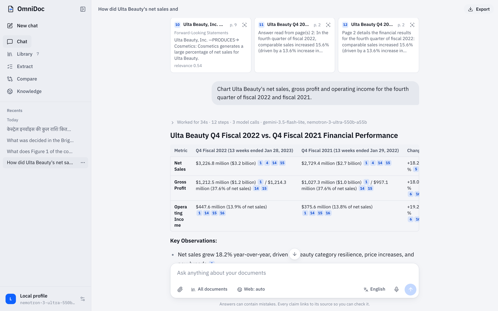</td>
</tr>
<tr>
<td>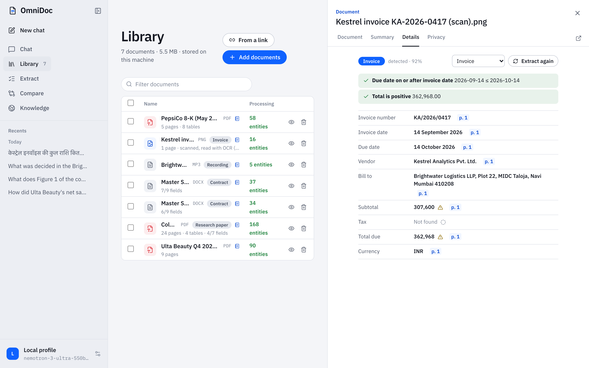</td>
<td valign="top">

**Document types, fields and checks**<br>
Each upload is classified (invoice, receipt, purchase order, contract, résumé, research paper, bank statement and more). Its template's fields are filled in the background, each with a verbatim quote, and validated: due date after invoice date, subtotal plus tax equals total.

</td>
</tr>
<tr>
<td valign="top">

**Find and redact sensitive data**<br>
The Privacy tab finds Aadhaar (checksum-verified), PAN, GSTIN, IFSC, card (Luhn), account, passport and voter-ID numbers, phone numbers, e-mail addresses and dates of birth, and downloads a truly redacted copy: text and pixels removed, metadata scrubbed.

</td>
<td>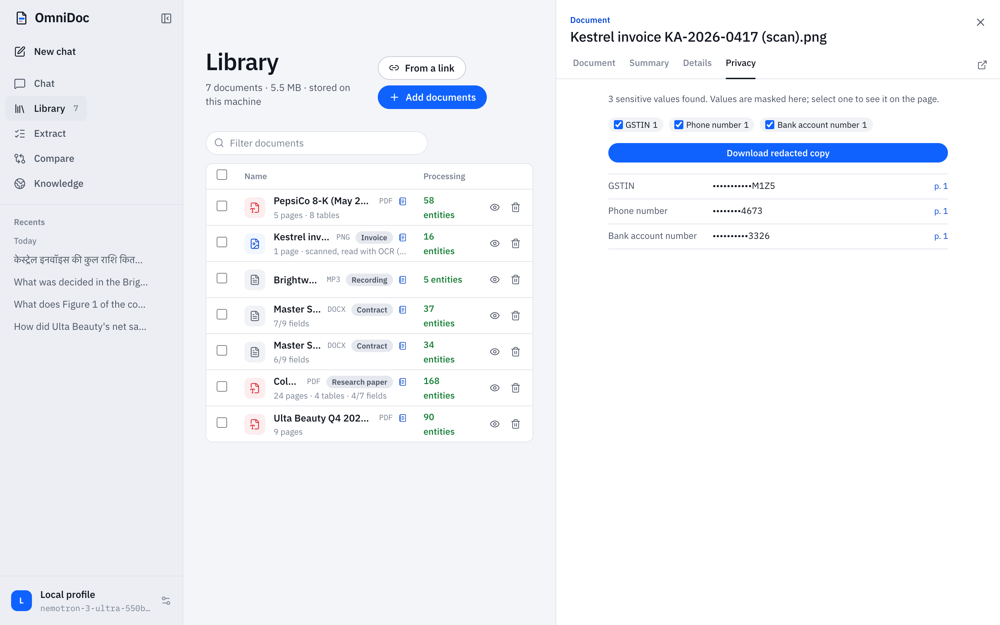</td>
</tr>
<tr>
<td>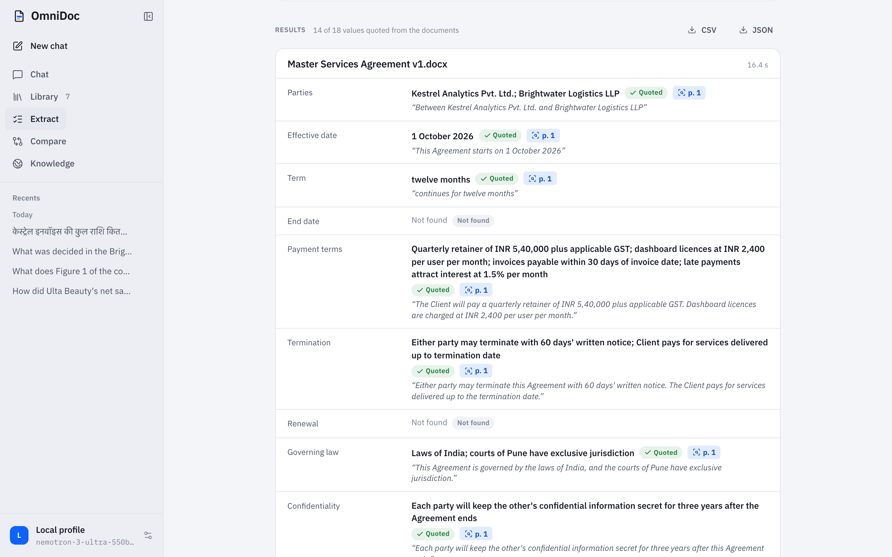</td>
<td valign="top">

**Extract structured data at scale**<br>
Fill any set of fields from many documents at once. Every value carries the passage it was quoted from; export to CSV or JSON.

</td>
</tr>
<tr>
<td valign="top">

**Compare versions**<br>
Two versions are aligned clause by clause, with word-level differences, changed figures and added or removed text, plus an optional summary of what matters.

</td>
<td>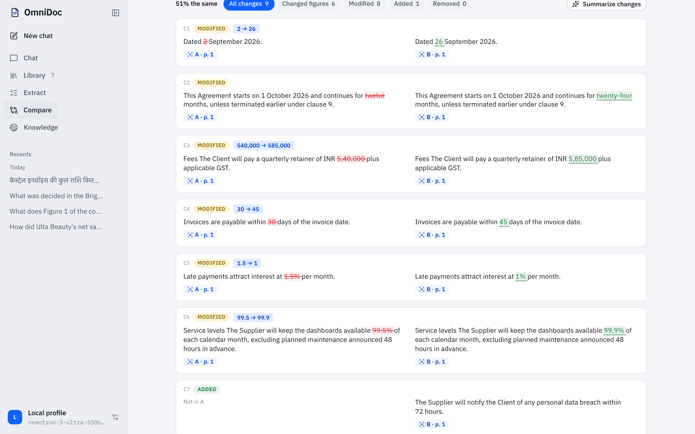</td>
</tr>
<tr>
<td>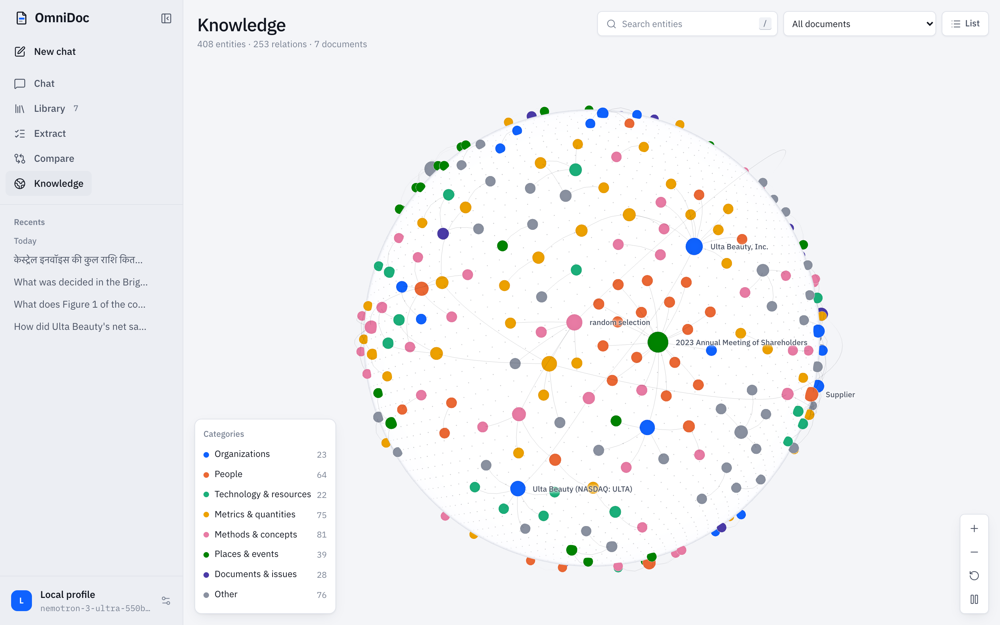</td>
<td valign="top">

**Knowledge graph**<br>
Entities and relations extracted from every document, explorable on an interactive globe and used to answer multi-hop questions.

</td>
</tr>
<tr>
<td valign="top">

**Multilingual, recordings and the web**<br>
Ask in Hindi, Marathi, Tamil, Telugu, Kannada, Bengali, Gujarati and more; the answer is written in your language. Recordings are transcribed with timestamps. When the documents do not answer a question, a web search agent reads and cites pages like documents.

</td>
<td>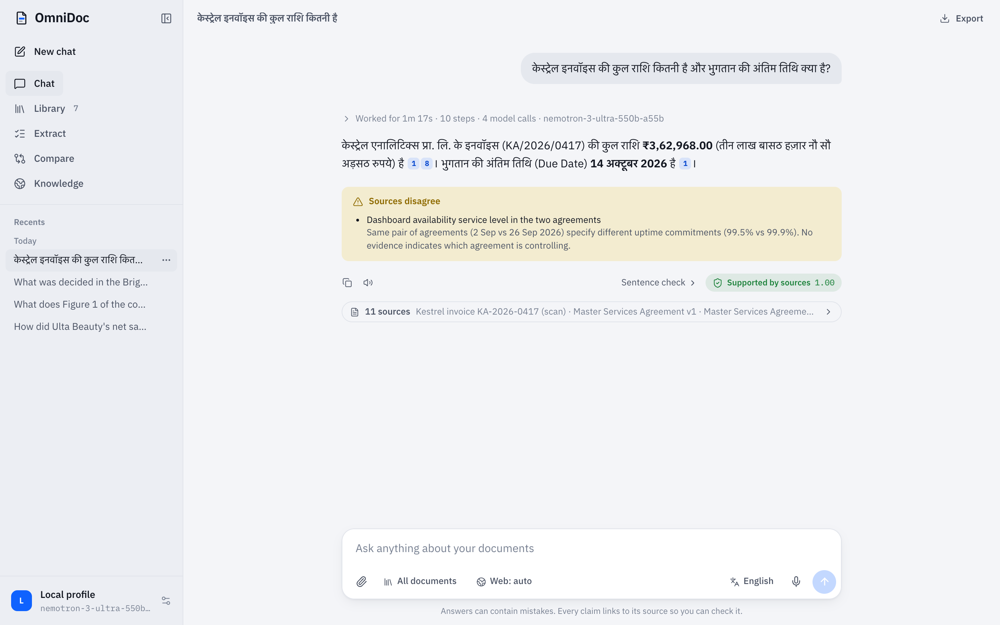</td>
</tr>
</table>

<div align="center">
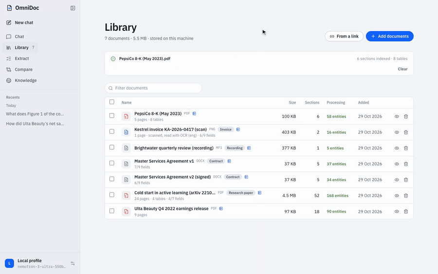
<br><sub>Extraction and comparison of two versions of a contract, at about four times real speed.</sub>
</div>

<br>

<table>
<tr>
<td width="50%">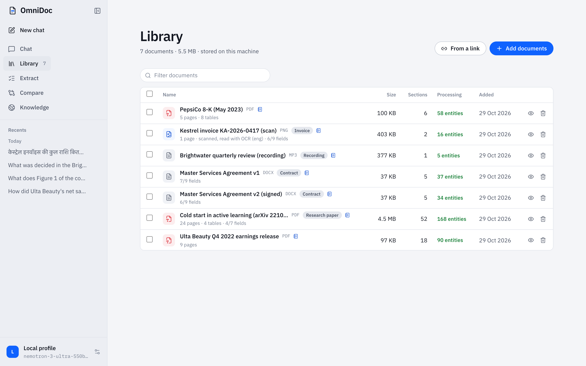</td>
<td width="50%">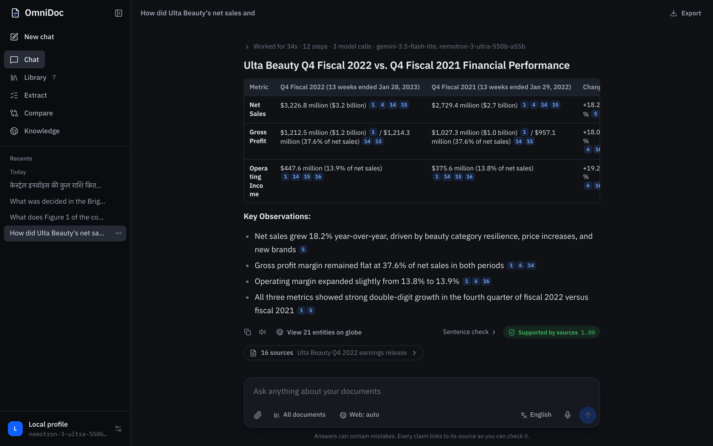</td>
</tr>
</table>

**Accounts for a hosted server:** sign-in with Google, GitHub or an e-mailed one-time code, a private library per account, daily limits and a storage cap per account, and self-service account deletion. Long conversations keep a rolling summary of earlier turns, so follow-up questions can refer back to anything said in the chat.

**Also included:** a light and a dark theme, conversation export to PDF and Word, voice input, per-question budgets for model calls and time, and an [MCP server](#use-from-mcp-clients) that makes your library available to Claude, Cursor and other AI tools.

## Quick start

**Docker** (one container serves the API and the web app):

```bash
git clone https://github.com/muditagrawal-alt/OmniDoc.git && cd OmniDoc
cp .env.example .env        # add at least one free API key, see "Model providers"
docker compose up -d        # http://localhost:8000
```

**From source** (Python 3.9+ and Node.js 20+):

```bash
cp .env.example .env                              # or run models locally: ollama pull qwen2.5:7b-instruct nomic-embed-text
brew install tesseract tesseract-lang ffmpeg      # optional: OCR for scans, transcripts for recordings
python3 -m venv .venv && source .venv/bin/activate
pip install -r requirements.txt
cd frontend && npm install && npm run build && cd ..
python server.py                                  # http://127.0.0.1:8000
```

For frontend development run `npm run dev` in `frontend/` (http://localhost:5173). PDF reports use WeasyPrint, which needs Pango on macOS (`brew install pango`).

## Benchmarks

OmniDoc is measured on public benchmarks with reference answers, and every run is kept in
[`benchmarks/results/`](benchmarks/results/HISTORY.md) with its configuration, answers and grades.
Answers are graded by a judge model from another family than the answer model.

| Benchmark | What it measures | Questions | OmniDoc |
|---|---|---|---|
| [FinanceBench](https://github.com/patronus-ai/financebench) | Questions on SEC filings: figures, ratios and financial judgement | 36 (test split) | **77.8%** |
| | | all 150 | **70.7%** |
| [MMLongBench-Doc](https://huggingface.co/datasets/yubo2333/MMLongBench-Doc) | Long PDFs with evidence in text, tables, charts and images | 53 (test split) | **71.7%** |
| | | first 255 of 1,072 | **57.3%** |
| [BEIR SciFact](https://github.com/beir-cellar/beir) | Retrieval alone, nDCG@10 (exact, no judge) | 300 claims | **0.732** |
| SciFact claims with [RAGAS](https://github.com/explodinggradients/ragas) | Verdict accuracy / faithfulness / answer relevancy | 300 claims | **78.0% / 75.7% / 80.1%** |

For reference, published results put standard retrieval-augmented pipelines near 50% on
FinanceBench and the strongest agentic systems near 84%; document-RAG systems on MMLongBench-Doc
report 50 to 65%. Across the baseline and four revisions, the test-split scores rose from 30.6% to 77.8% (FinanceBench)
and from 35.8% to 71.7% (MMLongBench-Doc); [`benchmarks/README.md`](benchmarks/README.md) explains
the method, the splits and how to reproduce every number.

<sub>Measured with NVIDIA's Nemotron 3 Super for answers, Gemini 3.5 Flash-Lite for figures and nomic-embed-text for embeddings, all on free tiers. NVIDIA has since retired Nemotron 3 Super; OmniDoc now defaults to Nemotron 3 Ultra.</sub>

## Architecture

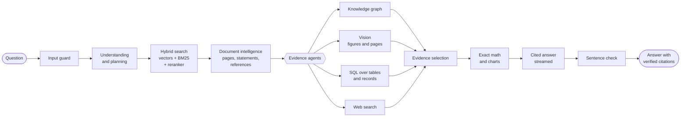

A typical question costs two or three model calls: understanding when it helps, writing and checking.
Optional steps run only when the question needs them and within a per-question budget, and the trace
under each answer shows every step, model call and model.

| Layer | Technology |
|---|---|
| API and orchestration | FastAPI, LangGraph |
| Retrieval | LanceDB (vectors), Tantivy (BM25), MiniLM cross-encoder, nomic-embed-text |
| Knowledge graph | Kùzu |
| Tables and records | SQLite with read-only SQL |
| Parsing | PyMuPDF, Tesseract OCR, python-docx, python-pptx, openpyxl, Whisper transcripts |
| Models | Gemini, Groq, NVIDIA NIM, Mistral, OpenRouter, Cerebras, GitHub Models or Ollama, with automatic fallback |
| Web app | React 19, TypeScript, Vite |

## Deployment

`docker compose up -d` runs OmniDoc in one container on port 8000. Before exposing it, set
`OMNIDOC_AUTH=user:password` in `.env`. Every visitor is then asked for it; serve it over HTTPS.

On a fresh Ubuntu server, one command installs Docker, opens the firewall, builds the image and starts
OmniDoc behind automatic HTTPS:

```bash
bash deploy/oracle-setup.sh
```

[`deploy/README.md`](deploy/README.md) walks through a free Oracle Cloud Always Free VM, a Cloudflare
tunnel from your own computer, and other hosts.

## Model providers

Add keys to `.env` (see [`.env.example`](.env.example)). The first configured provider answers; when
it is rate-limited, out of daily quota or too small for a request, the next one takes over, then local
Ollama if it runs. Settings → *Free model APIs and web search* shows what is configured.

| Provider | Free tier (October 2026) | Notes |
| --- | --- | --- |
| Google Gemini | Gemini 3.5 Flash-Lite (about 500 requests/day; 3.5 Flash only 20/day), embeddings, images | Prompts may be used to improve Google's models outside the EEA, UK and Switzerland |
| Groq | gpt-oss-120b/20b, Qwen; 30 requests/min, 1,000/day, 8,000 tokens/min per model; Whisper | Fastest; the small per-minute token limit means long prompts move to the next provider |
| NVIDIA NIM | Nemotron 3 Ultra, Kimi, GLM, DeepSeek and more; about 40 requests/min per model | NVIDIA Developer account; meant for development and evaluation |
| Mistral | Free Experiment plan | Requests may be used for training unless you opt out |
| OpenRouter | Models ending in `:free`; 50 requests/day (1,000 after a one-time $10 top-up) | Free routes rotate |
| Cerebras, GitHub Models | Trial credit / low daily limits | |

Web search: Tavily (1,000 searches a month free), Brave, Serper, your own SearXNG, or DuckDuckGo without a key.

## Use from MCP clients

```bash
claude mcp add omnidoc -- python /path/to/OmniDoc/mcp_server.py      # Claude Code
```

Claude Desktop (`claude_desktop_config.json`): `{"mcpServers": {"omnidoc": {"command": "python", "args": ["/path/to/OmniDoc/mcp_server.py"]}}}`.
Tools: `list_documents`, `search_documents`, `ask`, `read_document`, `extract_fields`, `find_sensitive_data`
and `compare_documents`. The server must be running (`OMNIDOC_API_URL`, and `OMNIDOC_API_AUTH` when it has a
password). The REST API is described at `/docs` (OpenAPI).

## Configuration

Model and search keys are listed in [`.env.example`](.env.example). Other settings:

| Variable | Default | Purpose |
| --- | --- | --- |
| `OMNIDOC_MODEL` | first configured provider, else `qwen2.5:7b-instruct` | Default model spec (`gemini:gemini-3.5-flash-lite`, `groq:openai/gpt-oss-120b`, or an Ollama name); switchable in the app |
| `OMNIDOC_LLM_PROVIDERS` | `gemini,groq,nvidia,mistral,cerebras,openrouter,github,custom` | Fallback order of hosted providers |
| `OMNIDOC_LOCAL_FALLBACK` / `OMNIDOC_CLOUD_FALLBACK` | `1` / `0` | Fall back from hosted models to Ollama / from Ollama to hosted models |
| `OMNIDOC_EMBED_MODEL` | Ollama `nomic-embed-text`, else a hosted embedding model, else `st:intfloat/multilingual-e5-small` on the CPU | Changing it re-indexes the library in the background. `nvidia:nvidia/nemotron-3-embed-1b` (free with an NVIDIA key) retrieves better (BEIR SciFact) |
| `OMNIDOC_DENSE_WEIGHT` | `1` | Weight of the vector ranking against keyword search in hybrid retrieval; about `3` suits a stronger embedder such as `nemotron-3-embed-1b` |
| `OMNIDOC_UNDERSTANDING` | `auto` | `auto`: model call only when it helps; `llm`: always; `rules`: never |
| `OMNIDOC_MAX_LLM_CALLS` / `OMNIDOC_MAX_SECONDS` | `8` / `180` | Per-question budget for optional steps |
| `OMNIDOC_WEB_SEARCH` | `auto` | `auto`, `on` or `off` (the interface can override per question) |
| `OMNIDOC_AUTO_EXTRACT` | `1` | Fill the detected type's template after upload |
| `OMNIDOC_VISION_MODEL` | Gemini when configured, else the first installed of `qwen3.5:9b`, `gemma4:12b`, `qwen2.5vl:7b` | Model that reads figures |
| `OMNIDOC_VISION_PAGES` / `OMNIDOC_VISION_WHOLE_PAGES` / `OMNIDOC_VISION_SCAN_PAGES` | `6` / `40` / `160` | Pages a hosted vision model reads together; PDFs this short are read whole; most pages scanned for questions about a whole document ("how many photos does this report have?") |
| `OMNIDOC_RETRIEVAL_TOP_K` / `OMNIDOC_EVIDENCE_PASSAGES` / `OMNIDOC_EVIDENCE_CHARS` | `10` / `10` / `2400` | Passages retrieved and handed to the writer, and their length, sized for hosted models (a small local model may want `6` / `6` / `1500`); financial statements and pages a question names come whole on top |
| `OMNIDOC_GRAPH_MEMORY_MB` | `512` | Memory the knowledge-graph database may use for its cache (Kùzu would otherwise take up to 80% of RAM) |
| `OMNIDOC_DATA_DIR` | `./.data` | Database, indexes, graph, uploads, caches |
| `OMNIDOC_ACCOUNTS` | `0` | `1`: every visitor signs in (Google, GitHub or an e-mailed code) and gets a private library; see [deploy/README.md](deploy/README.md#accounts-sign-in-for-everyone-you-share-it-with) |
| `OMNIDOC_DAILY_QUESTIONS` / `OMNIDOC_DAILY_UPLOADS` / `OMNIDOC_STORAGE_MB` | `40` / `20` / `200` | Limits per account with accounts on (administrators, `OMNIDOC_ADMIN_EMAILS`, have none) |
| `OMNIDOC_AUTH` | none | `user:password` required from every visitor (deployments; use HTTPS) |
| `OMNIDOC_GRAPH_CHUNKS` | `40` | Passages per document used for graph extraction (four per model call) |
| `OMNIDOC_SUMMARIES` | `1` | Summarize documents after upload |
| `OMNIDOC_OCR_LANGS` / `OMNIDOC_OCR_DPI` / `OMNIDOC_OCR_MIN_CONF` | detected / `200` / `55` | OCR languages, resolution and word confidence |
| `OMNIDOC_WHISPER_MODEL` | `whisper-large-v3-turbo` | Speech-to-text model (Groq), or `OMNIDOC_WHISPER_BASE_URL` for another endpoint |
| `OMNIDOC_MAX_UPLOAD_MB` | `100` | Upload size limit |
| `OMNIDOC_HOST` / `OMNIDOC_PORT` | `127.0.0.1` / `8000` | API address |
| `OLLAMA_HOST` | `http://localhost:11434` | Ollama address |

## Project layout

```text
server.py              FastAPI: profiles, conversations, streaming answers, documents and viewer, records,
                       sensitive data, comparison, extraction, web pages, search, graph, export, the built app
mcp_server.py          MCP server (stdio) over the REST API
core/                  LangGraph workflow, state, pipeline (ingestion and questions), streaming channel
agents/                understanding, planning, hybrid search, document intelligence, graph, vision, tables,
                       summaries, web search, temporal reasoning, evidence, conflicts, math, charts, synthesis,
                       extraction, document types, validation, comparison, model providers
guardrails/            input guard, intent, execution budget, output verification, sentence checks
retrieval/             LanceDB store, embeddings, reranker, SQLite tables and library records
graph/                 Kùzu store, schema, triple extraction
parsing/               PDF, Word, spreadsheet, slide, e-mail, EPUB, HTML and recording parsing; OCR,
                       transcription, tables, highlighting, sensitive data, safe web reading
frontend/              React 19 + TypeScript: chat, viewer, library, extract, compare, knowledge globe
benchmarks/            FinanceBench, MMLongBench-Doc, BEIR and RAGAS harnesses and every result
deploy/                deployment guide, one-command VM setup, HTTPS (Caddy)
tests/                 API, viewer, agents, providers, grounding and export tests
```

## Development

```bash
pytest tests/test_grounding.py tests/test_document_intelligence.py tests/test_intelligence_layer.py \
       tests/test_server_endpoints.py tests/test_report_compiler.py      # no model calls
pytest tests/test_viewer_endpoints.py                                   # uploads: needs Ollama embeddings
cd frontend && npx tsc -p tsconfig.app.json --noEmit && npx oxlint src && npm run build
```

The API tests run against a temporary data folder and never touch your library. Hosted providers are
tested against a local fake API server.

## Roadmap

- **Shared workspaces.** Folders and conversations shared between accounts, with roles.
- **Focused page reading.** Read the one or two pages a table or chart question needs at full resolution, and count by majority over repeated readings: the largest remaining source of errors on MMLongBench-Doc.
- **Watched sources.** Re-import a web page or online PDF on a schedule and report what changed, using the Compare engine.
- **Answer feedback.** Thumbs up or down on answers, collected into an evaluation set from real use.
- **Automatic backups.** Scheduled snapshots of the library to object storage for self-hosted deployments.
- **Mobile capture.** Photograph receipts and documents from a phone straight into the library.

## Privacy and security

With Ollama, inference, embeddings, figure reading, storage and export all stay on your machine. With
hosted APIs, the question and the selected passages are sent to the provider you configured (read its
data terms; some free tiers may train on prompts); the documents themselves stay in your data folder.
Web search sends the query to the search provider and fetches result pages from your server; addresses
on private networks are refused. Sessions use opaque tokens, and conversations are private to the
profile that created them.

## License

[MIT](LICENSE). Benchmark datasets keep their own licenses (FinanceBench: CC BY-NC 4.0). The demo uses
public SEC filings, an arXiv paper and sample documents written for it; its music is “Inspired” by
Kevin MacLeod ([incompetech.com](https://incompetech.com)), licensed under
[CC BY 4.0](https://creativecommons.org/licenses/by/4.0/).
