<div align="center">

<picture>
  <source media="(prefers-color-scheme: dark)" srcset="docs/media/logo-dark.svg">
  
</picture>

### Document intelligence with answers you can verify

Ask questions across PDFs, scans, contracts, spreadsheets, slide decks and recordings.<br>
Every claim cites the page it came from, and every sentence is checked against its source.

[](https://omnidoc-silk.vercel.app)
[](https://github.com/muditagrawal-alt/OmniDoc/actions/workflows/ci.yml)
[](#development)
[](LICENSE)
<br>
[](requirements.txt)
[](frontend/package.json)
[](#benchmarks)
[](#benchmarks)
[](#model-providers)

[**Try it live**](https://omnidoc-silk.vercel.app) · [**Watch the demo**](https://omnidoc-silk.vercel.app/demo/omnidoc-demo.mp4) · [Features](#features) · [Benchmarks](#benchmarks) · [Architecture](#architecture) · [Get started](#get-started) · [Deploy](#deployment) · [Security](#security)

<br>

<a href="https://omnidoc-silk.vercel.app/demo/omnidoc-demo.mp4">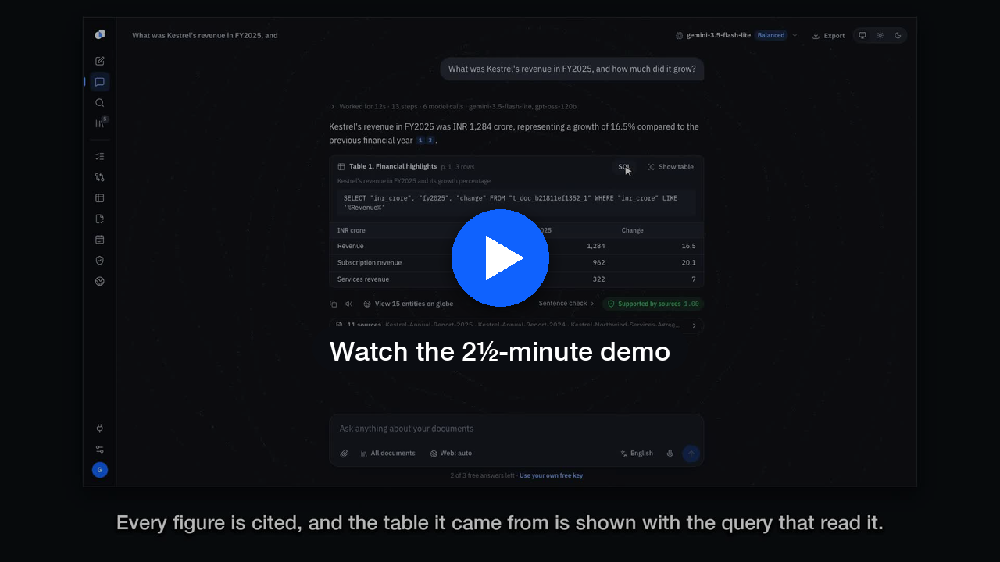</a>

<sub>A 2½-minute walkthrough with subtitles (also as <a href="docs/media/omnidoc-demo.mp4">MP4 in this repository</a> and <a href="docs/media/omnidoc-demo.srt">SRT</a>). Music: “Inspired” by Kevin MacLeod (incompetech.com), CC BY 4.0.</sub>

</div>

<br>

> [!TIP]
> **Try it in the browser, no account needed.** [omnidoc-silk.vercel.app](https://omnidoc-silk.vercel.app) opens on the
> product page; **Try the demo** gives you a read-only sample library (two annual reports, a contract, a scanned
> invoice and a summary in Hindi, all about a fictional company) and three free answers. Create an account with a
> password or a passkey to upload your own documents.

## Contents

- [Why OmniDoc](#why-omnidoc)
- [Demo](#demo)
- [Features](#features)
- [Benchmarks](#benchmarks)
- [Architecture](#architecture)
- [Get started](#get-started)
- [Deployment](#deployment)
- [Model providers](#model-providers)
- [Use from MCP clients](#use-from-mcp-clients)
- [Configuration](#configuration)
- [Security](#security)
- [Development](#development)
- [Roadmap](#roadmap)
- [Contributing](#contributing)
- [License and credits](#license-and-credits)

## Why OmniDoc

Most document assistants give fluent answers you cannot check. OmniDoc is built the other way round:
retrieval, reading and calculation are done by specialised agents, and an answer is only as strong as
the evidence it cites.

| | |
|---|---|
| **Verifiable** | Answers cite numbered sources. A citation opens the document at the cited page with the supporting sentence highlighted, and a verifier checks each sentence before you read it. |
| **Exact** | Figures come from the documents. Tables are queried with read-only SQL, calculations run in a restricted symbolic evaluator, and charts are drawn only from cited numbers. Contradictions across documents are flagged, never smoothed over. |
| **Every format** | PDFs, scans and photos (OCR, ten Indian languages included), Word, spreadsheets, slides, e-mails, e-books, web pages, and audio or video recordings. |
| **Free and yours** | Runs on the free tiers of hosted model APIs, or entirely on your machine with Ollama. Open source under the MIT licence, with no paid service anywhere in the stack. |

## Demo

<div align="center">

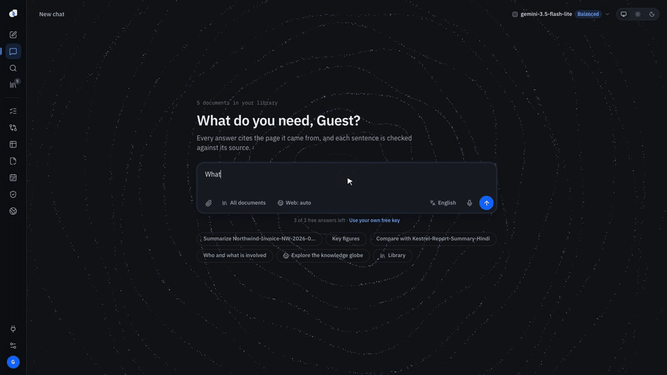

<sub>A question about the sample library: a cited answer, the table it came from with its SQL, and the cited page opened at the sentence.</sub>

</div>

<table>
<tr>
<td width="50%" align="center">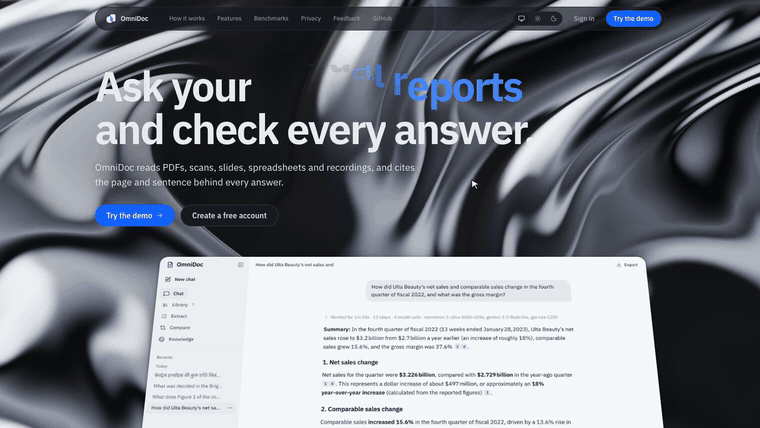<br><sub>The product page</sub></td>
<td width="50%" align="center">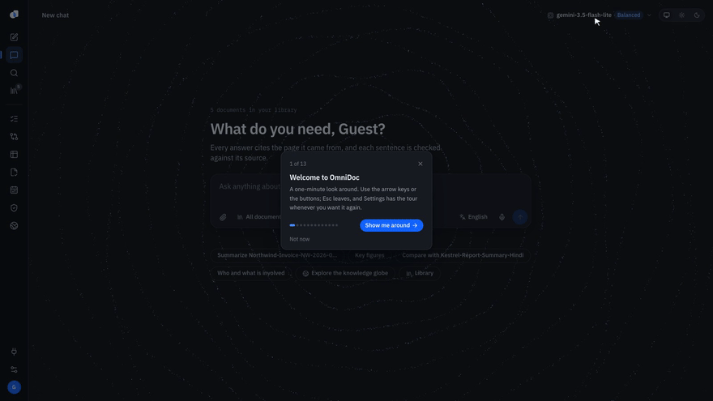<br><sub>The guided tour for new users</sub></td>
</tr>
<tr>
<td colspan="2" align="center">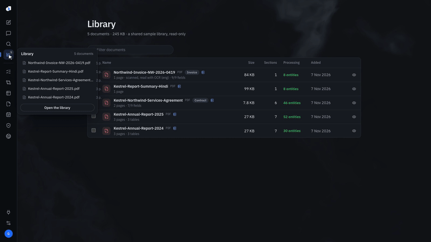<br><sub>Library tools: every table as data, the timeline, the privacy scan and the knowledge globe (sped up)</sub></td>
</tr>
</table>

## Features

<table>
<tr>
<td width="50%" valign="top">

**Cited answers, checked sentence by sentence**<br>
Answers stream in as they are written. Each sentence is checked against the passages it cites: figures must
appear there, wrong citation numbers are corrected, and unsupported claims are flagged with the reason. When a
table answers the question, it is shown with the SQL that read it.

</td>
<td width="50%">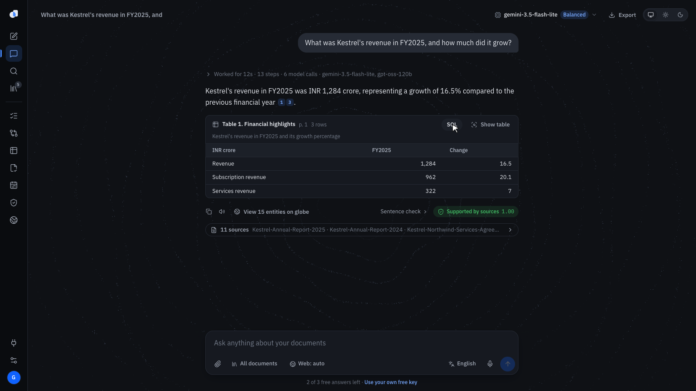</td>
</tr>
<tr>
<td>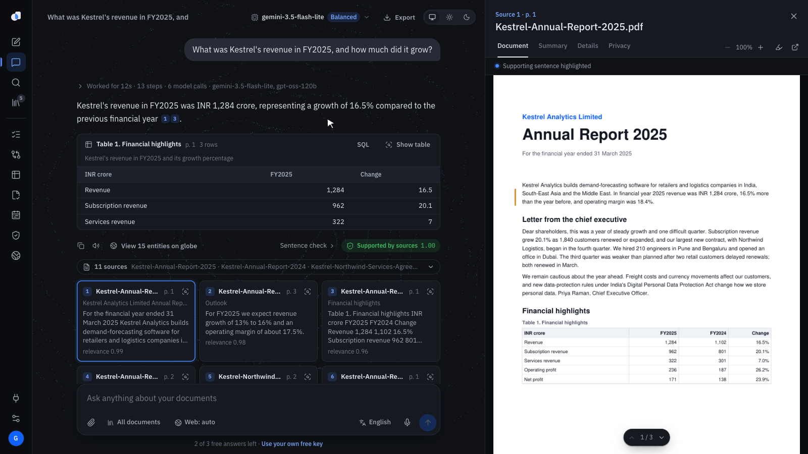</td>
<td valign="top">

**Open the evidence**<br>
Clicking a citation opens the document beside the answer at the cited page and highlights the sentence that
supports the claim. Scanned pages are highlighted from their OCR word positions; recordings play from the cited
moment.

</td>
</tr>
<tr>
<td valign="top">

**Extract structured data at scale**<br>
Fill any set of fields (or a template: invoice, contract, receipt, purchase order, résumé, bank statement,
research paper) from many documents at once. Every value carries the passage it was quoted from and is checked
against the document; export to CSV or JSON.

</td>
<td>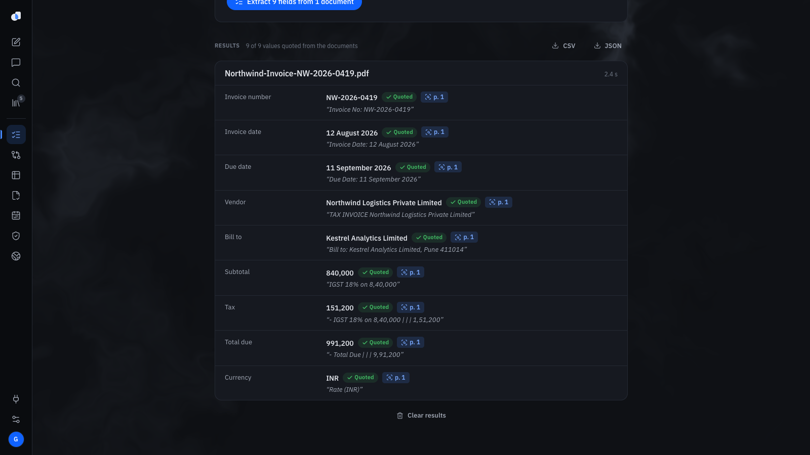</td>
</tr>
<tr>
<td>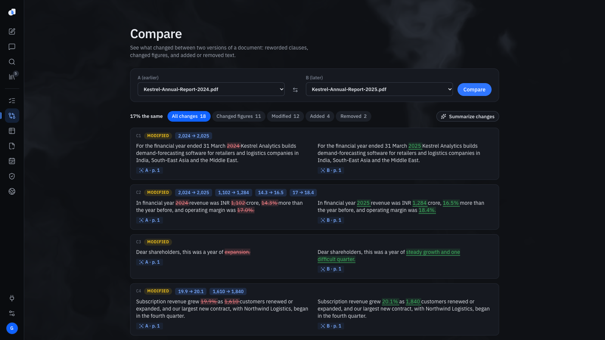</td>
<td valign="top">

**Compare versions**<br>
Two versions are aligned clause by clause, with word-level differences, changed figures and added or removed
text, plus an optional summary of what matters.

</td>
</tr>
<tr>
<td valign="top">

**Find and redact sensitive data**<br>
The privacy scan finds Aadhaar (checksum-verified), PAN, GSTIN, IFSC, card (Luhn), account, passport and voter-ID
numbers, phone numbers, e-mail addresses and dates of birth across the library, and downloads truly redacted
copies: text and pixels removed, metadata scrubbed.

</td>
<td>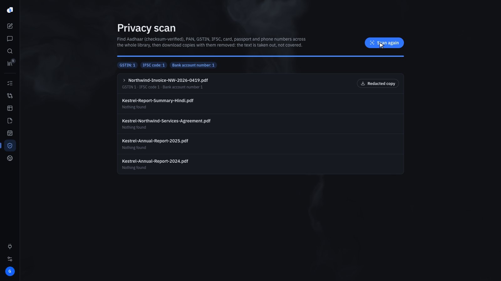</td>
</tr>
<tr>
<td>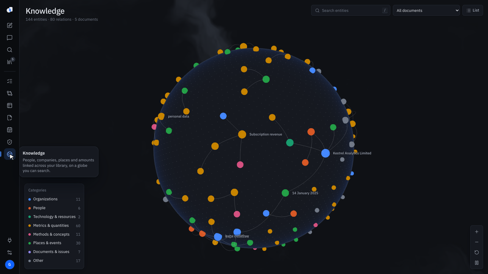</td>
<td valign="top">

**Knowledge graph**<br>
People, companies, places and amounts extracted from every document and linked across the library, explorable
on an interactive globe and used to answer multi-hop questions.

</td>
</tr>
<tr>
<td valign="top">

**Every table, record and date**<br>
**Tables** lists every table found in the library as data, opens it as a grid and downloads it as CSV.
**Records** shows each recognised invoice, receipt or contract with its fields and consistency checks.
**Timeline** puts every dated sentence in order, each linked to its page. **Search** finds passages by meaning
and exact words without a model call.

</td>
<td>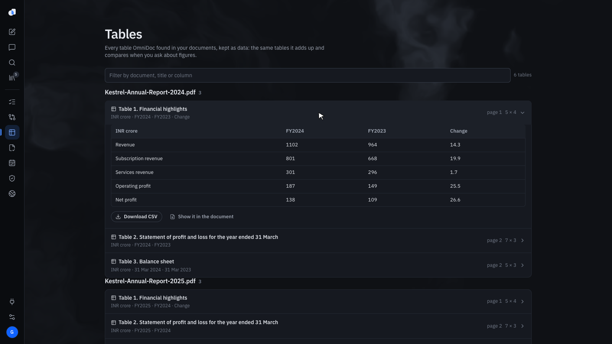</td>
</tr>
<tr>
<td>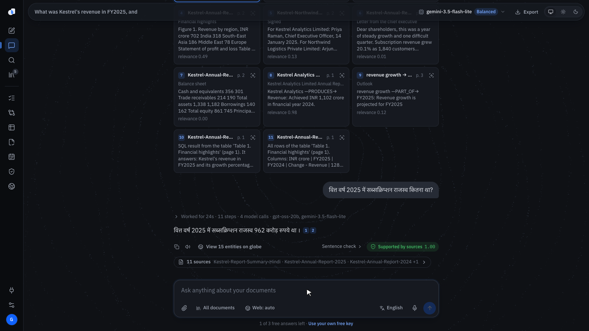</td>
<td valign="top">

**Multilingual, recordings and the web**<br>
Ask in Hindi, Marathi, Tamil, Telugu, Kannada, Bengali, Gujarati and more; the answer is written in your
language. Recordings are transcribed with timestamps. When the documents do not answer a question, a web search
agent reads and cites pages like documents.

</td>
</tr>
</table>

<details>
<summary><b>Accounts, workspace and everything else</b></summary>

<br>

- **Accounts without e-mail.** A username and password (scrypt-hashed; a forgotten password is reset with a
  one-time recovery code), a passkey (Face ID, Touch ID, Windows Hello, a phone), or GitHub and Google sign-in,
  with an authenticator app as a second step, a devices list with remote sign-out, and profile pictures from
  GitHub, Google or Gravatar.
- **A private library per account**, daily limits and a storage cap, export of everything as a zip, and
  self-service account deletion.
- **Free to use.** Every account gets three answers on the server's free model keys; then users add their own
  free key, kept in their browser or, if they choose, encrypted on the server.
- **A guided tour** of the workspace for new users, and a read-only **guest demo** behind a proof-of-work check
  and per-address limits.
- **Your choices.** Each user picks their own answer model and effort (Quick, Balanced or Thorough), a system,
  light or dark theme, an accent colour, text size, density, motion and backgrounds; desktop navigation is an icon
  rail with flyouts or a full sidebar.
- **For the operator.** An Admin tab with usage, server health and memory, the default model, announcements, and
  feedback from the product page, which also arrives by e-mail (Resend or any SMTP service).
- **Also included.** Conversation export to PDF and Word, voice input, a rolling summary of long conversations,
  per-question budgets for model calls and time, and an [MCP server](#use-from-mcp-clients) for Claude, Cursor and
  other AI tools.

<table>
<tr>
<td width="50%">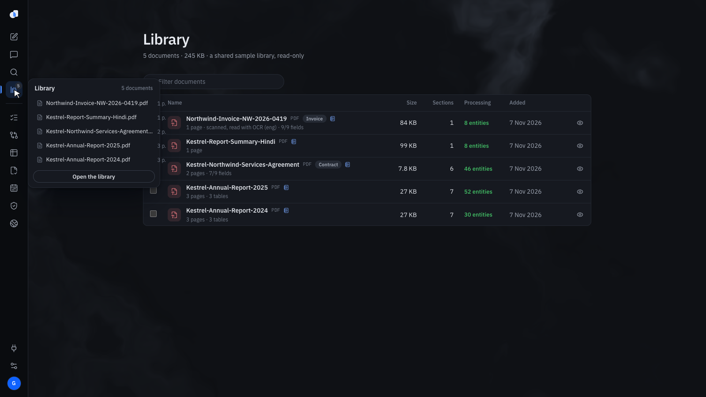</td>
<td width="50%">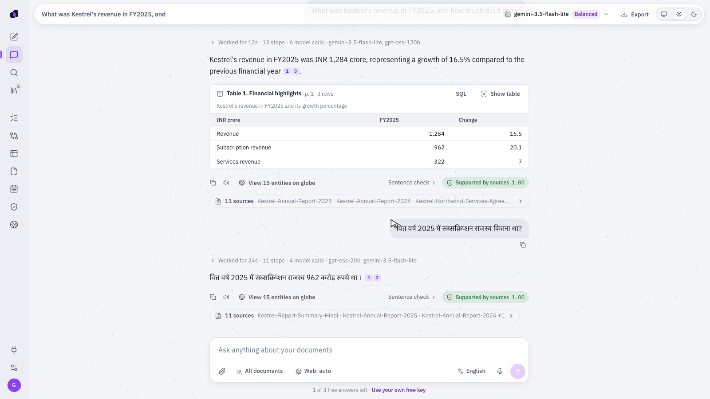</td>
</tr>
<tr>
<td width="50%">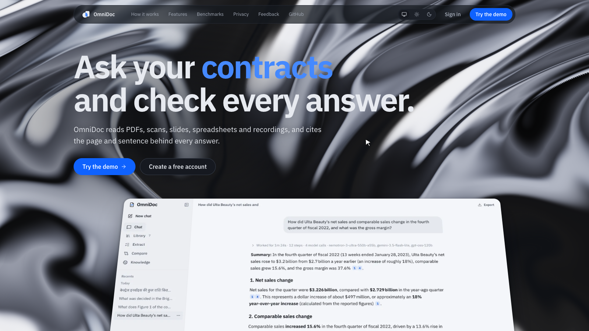</td>
<td width="50%">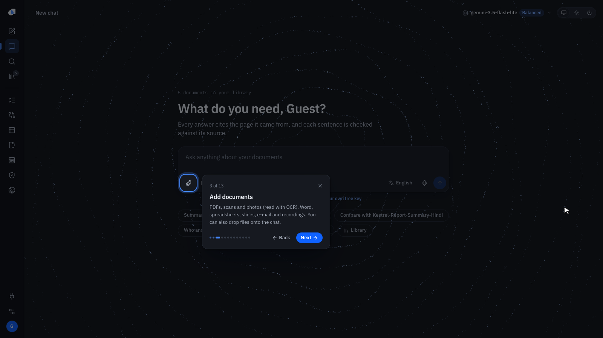</td>
</tr>
</table>

</details>

## Benchmarks

OmniDoc is measured on public benchmarks with reference answers, and every run is kept in
[`benchmarks/results/`](benchmarks/results/HISTORY.md) with its configuration, answers and grades. Answers are
graded by a judge model from another family than the answer model.

| Benchmark | What it measures | Questions | OmniDoc |
|---|---|---|---|
| [FinanceBench](https://github.com/patronus-ai/financebench) | Questions on SEC filings: figures, ratios and financial judgement | 36 (test split) | **77.8%** |
| | | all 150 | **70.7%** |
| [MMLongBench-Doc](https://huggingface.co/datasets/yubo2333/MMLongBench-Doc) | Long PDFs with evidence in text, tables, charts and images | 53 (test split) | **71.7%** |
| | | first 255 of 1,072 | **57.3%** |
| [BEIR SciFact](https://github.com/beir-cellar/beir) | Retrieval alone, nDCG@10 (exact, no judge) | 300 claims | **0.732** |
| SciFact claims with [RAGAS](https://github.com/explodinggradients/ragas) | Verdict accuracy / faithfulness / answer relevancy | 300 claims | **78.0% / 75.7% / 80.1%** |

For reference, published results put standard retrieval-augmented pipelines near 50% on FinanceBench and the
strongest agentic systems near 84%; document-RAG systems on MMLongBench-Doc report 50 to 65%. Across the baseline
and four revisions, the test-split scores rose from 30.6% to 77.8% (FinanceBench) and from 35.8% to 71.7%
(MMLongBench-Doc); [`benchmarks/README.md`](benchmarks/README.md) explains the method, the splits and how to
reproduce every number.

<sub>Measured with NVIDIA's Nemotron 3 Super for answers, Gemini 3.5 Flash-Lite for figures and nomic-embed-text for embeddings, all on free tiers. NVIDIA has since retired Nemotron 3 Super; OmniDoc now defaults to Nemotron 3 Ultra.</sub>

## Architecture

**How a question is answered.** A typical question costs two or three model calls (understanding when it helps,
writing and checking). Optional steps run only when the question needs them and within a per-question budget,
and the trace under each answer shows every step, model call and model.

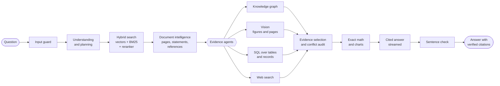

**How the live service is deployed.** Everything runs on free tiers. Vercel serves the web app and forwards
`/api` to the server under a secret path, so the site is one origin (cookies and passkeys just work) and the
server can trust the visitor address Vercel reports.

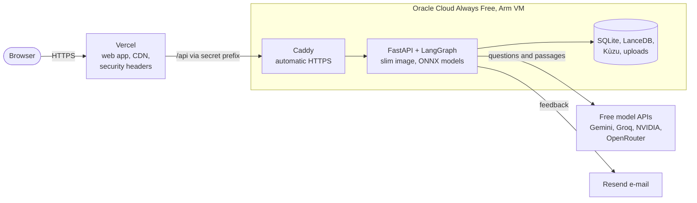

**Built for traffic.** The parts that see the most traffic never reach the server, and the server protects
itself when a crowd arrives:

- **At the edge.** Vercel's CDN serves the web app, its hashed assets (cached for a year), the product page's
  images and the public sign-in check, so a wave of visitors to the product page costs the server almost nothing.
  Visitors to the product page download only its code (about 570 KB of JavaScript); the workspace loads after
  sign-in.
- **Answers are admitted, not piled up.** At most `OMNIDOC_MAX_ANSWERS` answers (6) and `OMNIDOC_MAX_UPLOADS`
  uploads (2) run at once; the rest wait briefly ("Waiting for a free moment") and are then told to try again in a
  minute, so the CPU, memory and free model quotas are never overrun and everyone else stays fast.
- **The demo's questions are answered once.** The sample library is the same for every visitor, so the first
  answer to a question is recorded and replayed instantly for the next visitors, with no model call.
- **Quick requests never wait behind slow ones.** Sessions are checked off the event loop, 200 worker threads
  (`OMNIDOC_THREADS`) keep long answer streams from starving quick requests, and beyond `OMNIDOC_MAX_CONNECTIONS`
  the server sheds load with a 503 instead of slowing down for everyone.

| Measured on one process (6,000 requests, 50 at a time) | Before | After |
|---|---|---|
| Public sign-in check | 3,748 req/s, p99 57 ms | **7,341 req/s, p99 7 ms** (and cached at the CDN) |
| Health check | 1,034 req/s, p99 97 ms | **4,707 req/s, p99 36 ms** |
| Signed-in reads (documents, chats) | ~2,300 req/s, p99 66 ms | ~2,200 req/s, p99 66 ms, without blocking other requests |

| Layer | Technology |
|---|---|
| API and orchestration | FastAPI, LangGraph |
| Retrieval | LanceDB (vectors), Tantivy (BM25), cross-encoder reranker, nomic-embed-text or int8 ONNX models |
| Knowledge graph | Kùzu |
| Tables and records | SQLite, queried read-only through an authorizer that allows only the asking account's tables |
| Parsing | PyMuPDF, Tesseract OCR, python-docx, python-pptx, openpyxl, Whisper transcripts |
| Models | Gemini, Groq, NVIDIA NIM, Mistral, OpenRouter, Cerebras, GitHub Models or Ollama, with automatic fallback |
| Web app | React 19, TypeScript, Vite, Motion; WebGL backgrounds and the knowledge globe |
| Hosting | Vercel (web app), Oracle Cloud Always Free Arm VM with Caddy (server), GitHub Actions and GHCR (CI, images) |

## Get started

**Docker** (one container serves the API and the web app):

```bash
git clone https://github.com/muditagrawal-alt/OmniDoc.git && cd OmniDoc
cp .env.example .env        # add at least one free API key, see "Model providers"
docker compose up -d        # http://localhost:8000
```

**From source** (Python 3.9+ and Node.js 20+):

```bash
cp .env.example .env                              # or run models locally: ollama pull qwen2.5:7b-instruct nomic-embed-text
brew install tesseract tesseract-lang ffmpeg      # optional: OCR for scans, transcripts for recordings
python3 -m venv .venv && source .venv/bin/activate
pip install -r requirements.txt
cd frontend && npm install && npm run build && cd ..
python server.py                                  # http://127.0.0.1:8000
```

For frontend development run `npm run dev` in `frontend/` (http://localhost:5173). PDF reports use WeasyPrint,
which needs Pango on macOS (`brew install pango`).

## Deployment

| Where | What you get | Guide |
|---|---|---|
| **Oracle Cloud + Vercel** (what runs [the live demo](https://omnidoc-silk.vercel.app)) | An Always Free Arm VM for the server, Vercel's free plan for the web app; accounts, the demo, HTTPS and nightly backups | [`deploy/README.md`](deploy/README.md#oracle-cloud-always-free-vm-with-vercel-in-front) |
| Any Ubuntu VM | `bash deploy/oracle-setup.sh`: Docker, firewall, the published image, Caddy with HTTPS | [`deploy/README.md`](deploy/README.md) |
| 1 GB of memory | [`deploy/Dockerfile.slim`](deploy/Dockerfile.slim): the whole app without PyTorch or Ollama, int8 ONNX models; CI checks its peak memory (about 790 MB) on every push | [`deploy/CLAWCLOUD.md`](deploy/CLAWCLOUD.md) |
| Your own computer | `docker compose up -d`, optionally a Cloudflare tunnel for a public address | [`deploy/README.md`](deploy/README.md) |

CI publishes the slim image for amd64 and arm64 to GitHub's container registry
(`ghcr.io/muditagrawal-alt/omnidoc:slim`) after the tests pass.

## Model providers

Add keys to `.env` (see [`.env.example`](.env.example)). The first configured provider answers; when it is
rate-limited, out of daily quota or too small for a request, the next one takes over, then local Ollama if it
runs. Settings → *Free model APIs and web search* shows what is configured.

| Provider | Free tier (October 2026) | Notes |
| --- | --- | --- |
| Google Gemini | Gemini 3.5 Flash-Lite (about 500 requests/day; 3.5 Flash only 20/day), embeddings, images | Prompts may be used to improve Google's models outside the EEA, UK and Switzerland |
| Groq | gpt-oss-120b/20b, Qwen; 30 requests/min, 1,000/day, 8,000 tokens/min per model; Whisper | Fastest; the small per-minute token limit means long prompts move to the next provider |
| NVIDIA NIM | Nemotron 3 Ultra, Kimi, GLM, DeepSeek and more; about 40 requests/min per model | NVIDIA Developer account; meant for development and evaluation |
| Mistral | Free Experiment plan | Requests may be used for training unless you opt out |
| OpenRouter | Models ending in `:free`; 50 requests/day (1,000 after a one-time $10 top-up) | Free routes rotate |
| Cerebras, GitHub Models | Trial credit / low daily limits | |

Web search: Tavily (1,000 searches a month free), Brave, Serper, your own SearXNG, or DuckDuckGo without a key.

## Use from MCP clients

```bash
claude mcp add omnidoc -- python /path/to/OmniDoc/mcp_server.py      # Claude Code
```

Claude Desktop (`claude_desktop_config.json`): `{"mcpServers": {"omnidoc": {"command": "python", "args": ["/path/to/OmniDoc/mcp_server.py"]}}}`.
Tools: `list_documents`, `search_documents`, `ask`, `read_document`, `extract_fields`, `find_sensitive_data` and
`compare_documents`. The server must be running (`OMNIDOC_API_URL`, and `OMNIDOC_API_AUTH` when it has a
password). For a hosted server with accounts, create a token on the app's **Connect** page and pass it as
`OMNIDOC_API_TOKEN`; the page shows the exact command for Claude Code, Claude Desktop and Cursor. A local install
describes its REST API at `/docs` (OpenAPI); hosted servers do not publish it unless `OMNIDOC_API_DOCS=1`.

## Configuration

Model and search keys are listed in [`.env.example`](.env.example). Other settings:

| Variable | Default | Purpose |
| --- | --- | --- |
| `OMNIDOC_MODEL` | first configured provider, else `qwen2.5:7b-instruct` | Default model spec (`gemini:gemini-3.5-flash-lite`, `groq:openai/gpt-oss-120b`, or an Ollama name); switchable in the app |
| `OMNIDOC_LLM_PROVIDERS` | `gemini,groq,nvidia,mistral,cerebras,openrouter,github,custom` | Fallback order of hosted providers |
| `OMNIDOC_LOCAL_FALLBACK` / `OMNIDOC_CLOUD_FALLBACK` | `1` / `0` | Fall back from hosted models to Ollama / from Ollama to hosted models |
| `OMNIDOC_EMBED_MODEL` | Ollama `nomic-embed-text`, else a hosted embedding model, else `st:intfloat/multilingual-e5-small` on the CPU | Changing it re-indexes the library in the background. `nvidia:nvidia/nemotron-3-embed-1b` (free with an NVIDIA key) retrieves better (BEIR SciFact) |
| `OMNIDOC_DENSE_WEIGHT` | `1` | Weight of the vector ranking against keyword search in hybrid retrieval; about `3` suits a stronger embedder such as `nemotron-3-embed-1b` |
| `OMNIDOC_UNDERSTANDING` | `auto` | `auto`: model call only when it helps; `llm`: always; `rules`: never |
| `OMNIDOC_MAX_LLM_CALLS` / `OMNIDOC_MAX_SECONDS` | `8` / `180` | Per-question budget for optional steps |
| `OMNIDOC_WEB_SEARCH` | `auto` | `auto`, `on` or `off` (the interface can override per question) |
| `OMNIDOC_AUTO_EXTRACT` | `1` | Fill the detected type's template after upload |
| `OMNIDOC_VISION_MODEL` | Gemini when configured, else the first installed of `qwen3.5:9b`, `gemma4:12b`, `qwen2.5vl:7b` | Model that reads figures |
| `OMNIDOC_VISION_PAGES` / `OMNIDOC_VISION_WHOLE_PAGES` / `OMNIDOC_VISION_SCAN_PAGES` | `6` / `40` / `160` | Pages a hosted vision model reads together; PDFs this short are read whole; most pages scanned for questions about a whole document |
| `OMNIDOC_RETRIEVAL_TOP_K` / `OMNIDOC_EVIDENCE_PASSAGES` / `OMNIDOC_EVIDENCE_CHARS` | `10` / `10` / `2400` | Passages retrieved and handed to the writer, and their length, sized for hosted models (a small local model may want `6` / `6` / `1500`) |
| `OMNIDOC_GRAPH_MEMORY_MB` | `512` | Memory the knowledge-graph database may use for its cache |
| `OMNIDOC_DATA_DIR` | `./.data` | Database, indexes, graph, uploads, caches |
| `OMNIDOC_ACCOUNTS` | `0` | `1`: every visitor signs in (a password, a passkey, GitHub, Google or an e-mailed code) and gets a private library; see [deploy/README.md](deploy/README.md#accounts-sign-in-for-everyone-you-share-it-with) |
| `OMNIDOC_PASSWORDS` / `OMNIDOC_PASSKEYS` | `1` / `1` | Username-and-password and passkey accounts (with accounts on) |
| `OMNIDOC_DEMO` | `0` | `1` (with accounts): "Try the demo" opens a read-only guest session on the sample library |
| `OMNIDOC_DAILY_QUESTIONS` / `OMNIDOC_DAILY_UPLOADS` / `OMNIDOC_STORAGE_MB` | `40` / `20` / `200` | Limits per account with accounts on (administrators have none) |
| `OMNIDOC_ADMIN_CODE` | generated, printed to the log | Setup code that makes a signed-in account the administrator |
| `OMNIDOC_FEEDBACK_EMAIL` | none | Address that receives every piece of feedback, through `RESEND_API_KEY` (Resend) or `OMNIDOC_SMTP_*` |
| `OMNIDOC_EMAIL_SIGNIN` | `1` | `0` keeps SMTP for the operator's own notices: no e-mailed sign-in codes to visitors |
| `OMNIDOC_PUBLIC_URL` | `http://127.0.0.1:8000` | The address people open (passkeys, sign-in redirects, links in e-mails) |
| `OMNIDOC_PROXY_KEY` | none | Secret path prefix a front end on another host (Vercel) forwards `/api` under |
| `OMNIDOC_API_DOCS` | `1` locally, `0` with accounts | Publish the interactive API docs at `/docs` |
| `OMNIDOC_MAX_ANSWERS` / `OMNIDOC_MAX_UPLOADS` / `OMNIDOC_QUEUE_SECONDS` | `6` / `2` / `25` | Answers and uploads worked on at once, and how long a request waits for a free slot before "try again" |
| `OMNIDOC_DEMO_CACHE_HOURS` | `12` | How long a demo answer is replayed for the next visitors who ask the same first question |
| `OMNIDOC_THREADS` / `OMNIDOC_MAX_CONNECTIONS` | `200` / `2000` | Worker threads for requests, and connections at once before the server answers 503 |
| `OMNIDOC_AUTH` | none | `user:password` required from every visitor (a private deployment without accounts; use HTTPS) |
| `OMNIDOC_SUMMARIES` | `1` | Summarize documents after upload |
| `OMNIDOC_OCR_LANGS` / `OMNIDOC_OCR_DPI` / `OMNIDOC_OCR_MIN_CONF` | detected / `200` / `55` | OCR languages, resolution and word confidence |
| `OMNIDOC_WHISPER_MODEL` | `whisper-large-v3-turbo` | Speech-to-text model (Groq), or `OMNIDOC_WHISPER_BASE_URL` for another endpoint |
| `OMNIDOC_MAX_UPLOAD_MB` | `100` | Upload size limit |
| `OMNIDOC_HOST` / `OMNIDOC_PORT` | `127.0.0.1` / `8000` | API address |
| `OLLAMA_HOST` | `http://localhost:11434` | Ollama address |

## Security

OmniDoc is built to be put on the internet. The live service was audited from outside (requests without sign-in,
one account reaching for another's data, path traversal, secret scans of the site and the git history), and the
measures below are covered by the test suite. See [`SECURITY.md`](SECURITY.md) to report a vulnerability.

- **Isolation between accounts.** Every document, chat, page image, table, record and search is scoped to the
  account that owns it; another account or a guest gets *not found*. Model-written SQL runs on a read-only
  connection through an SQLite authorizer that allows one `SELECT` over the asking account's own tables only, so
  a prompt injection cannot reach anyone else's data.
- **Credentials.** Passwords are scrypt hashes (N=2<sup>15</sup>), session tokens are stored hashed, recovery
  codes are one-time, and administrators need two-step sign-in. API keys a user saves on the server are
  encrypted; none of the server's keys ever reach the browser.
- **Abuse protection.** A proof-of-work check before sign-up, guest sessions and feedback; per-address and
  per-username limits on sign-in attempts; daily limits per account; and an hourly cap on outgoing e-mail.
- **Browser hardening.** A strict Content-Security-Policy (the app's own scripts only), HSTS, no framing,
  `nosniff`, an isolated opener, and an HttpOnly, SameSite=Strict media cookie scoped to document images.
- **Server hardening.** The container runs as an unprivileged user; SSH accepts keys only and never root;
  only SSH, HTTP and HTTPS are open; security updates install automatically; hosted servers publish no API map and
  a minimal health check.
- **Privacy.** With Ollama, everything stays on your machine. With hosted APIs, the question and the selected
  passages go to the provider you configured (read its data terms; some free tiers may train on prompts); the
  documents themselves stay on your server. Web pages are fetched by the server, and private network addresses
  are refused.

## Development

```bash
pytest                                                                  # 211 tests, against a throwaway data folder
cd frontend && npx tsc -b && npx oxlint src && npm run build            # types, lint, production build
```

The tests never touch your library or send real mail, and hosted providers are tested against a local fake API.
CI runs the backend tests, the web app checks and a memory budget for the slim image on every push.

```text
server.py              FastAPI: accounts, conversations, streaming answers, documents and viewer, records,
                       sensitive data, comparison, extraction, web pages, search, graph, admin, the built app
mcp_server.py          MCP server (stdio) over the REST API
core/                  LangGraph workflow, pipeline, accounts, passwords, passkeys, abuse limits, notices, proxy
agents/                understanding, planning, hybrid search, document intelligence, graph, vision, tables,
                       summaries, web search, temporal reasoning, evidence, conflicts, math, charts, synthesis,
                       extraction, document types, validation, comparison, model providers
guardrails/            input guard, intent, execution budget, output verification, sentence checks
retrieval/             LanceDB store, embeddings, reranker, SQLite tables and library records
graph/                 Kùzu store, schema, triple extraction
parsing/               PDF, Word, spreadsheet, slide, e-mail, EPUB, HTML and recording parsing; OCR,
                       transcription, tables, highlighting, sensitive data, safe web reading
frontend/              React 19 + TypeScript: product page, chat, viewer, library tools, knowledge globe, tour
benchmarks/            FinanceBench, MMLongBench-Doc, BEIR and RAGAS harnesses and every result
deploy/                deployment guides, Oracle and Vercel scripts, Caddy, the slim image, the demo library
tests/                 API, security, accounts, viewer, agents, providers, grounding and export tests
```

## Roadmap

- **Shared workspaces.** Folders and conversations shared between accounts, with roles.
- **Focused page reading.** Read the one or two pages a table or chart question needs at full resolution, and count by majority over repeated readings: the largest remaining source of errors on MMLongBench-Doc.
- **Watched sources.** Re-import a web page or online PDF on a schedule and report what changed, using the Compare engine.
- **Answer feedback.** Thumbs up or down on answers, collected into an evaluation set from real use.
- **Mobile capture.** Photograph receipts and documents from a phone straight into the library.

## Contributing

Issues and pull requests are welcome. Please run the tests and the web app checks above before opening a pull
request, keep changes focused, and describe what you measured if a change affects answers. Security issues go
through [`SECURITY.md`](SECURITY.md), not public issues.

## License and credits

[MIT](LICENSE). Benchmark datasets keep their own licenses (FinanceBench: CC BY-NC 4.0). The sample library is
written for the demo about fictional companies. The demo's music is “Inspired” by Kevin MacLeod
([incompetech.com](https://incompetech.com)), licensed under [CC BY 4.0](https://creativecommons.org/licenses/by/4.0/).
Some product-page animations are adapted from [React Bits](https://reactbits.dev); the other backgrounds are
written for OmniDoc.

<div align="center">
<br>
<a href="https://omnidoc-silk.vercel.app"><b>omnidoc-silk.vercel.app</b></a>
</div>
